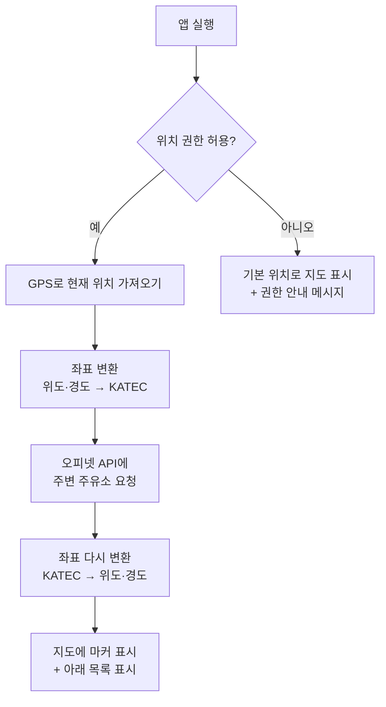

# ⛽ FindCheapGas

> **앱을 켜면 내 주변에서 가장 싼 주유소를 지도에 바로 보여주는 안드로이드 앱**

앱을 실행하면 현재 위치를 기준으로 지도가 열리고, 주변 주유소들의 기름값이 지도 위에 표시됩니다.
가장 싼 곳이 한눈에 보이고, 원하는 지역이나 주유소를 검색하거나 자주 가는 주유소를 즐겨찾기할 수도 있습니다.

<br>

## 📑 목차

1. [이런 앱이에요](#-이런-앱이에요)
2. [주요 기능](#-주요-기능)
3. [화면 구성](#-화면-구성)
4. [동작 원리](#-동작-원리)
5. [사용한 기술](#-사용한-기술)
6. [사용한 외부 API](#-사용한-외부-api)
7. [API 호출 횟수 제한 대응](#-api-호출-횟수-제한-대응)
8. [프로젝트 구조](#-프로젝트-구조)
9. [직접 실행해보기](#-직접-실행해보기)
10. [개발 진행 상황](#-개발-진행-상황)
11. [데이터 출처](#-데이터-출처)

<br>

## 🙋 이런 앱이에요

| 이런 고민이 있다면 | 이 앱에서는 |
|---|---|
| 근처 주유소 중 어디가 제일 싼지 모르겠어요 | 앱을 켜면 **주변 주유소 가격이 지도에 바로** 표시돼요 |
| 다른 동네에 가기 전에 미리 가격을 알고 싶어요 | **지역이나 장소를 검색**하면 그 주변 주유소를 보여줘요 |
| 자주 가는 주유소 가격만 빨리 보고 싶어요 | **즐겨찾기**에 저장해두고 한 번에 확인해요 |
| 이 가격이 싼 건지 비싼 건지 모르겠어요 | **전국·지역 평균가와 비교**해서 알려줘요 |

<br>

## ✨ 주요 기능

기능은 중요도에 따라 3단계로 나누어 순서대로 개발합니다.

### 1단계: 핵심 기능
| 기능 | 설명 |
|---|---|
| 📍 현재 위치 지도 | 앱을 켜면 위치 권한을 요청하고, 내 위치를 중심으로 지도를 보여줘요. 내 위치는 점으로 표시돼요 |
| ⛽ 주변 주유소 표시 | 주변 주유소를 지도에 마커로 표시하고, 마커에 가격을 함께 보여줘요. 가장 싼 곳은 다른 색으로 강조해요 |
| 🛢️ 유종 선택 | 휘발유 / 경유 / 고급휘발유 / LPG 중에서 고를 수 있어요 |
| 📏 반경 선택 | 1km / 3km / 5km 중에서 고를 수 있어요 |
| ↕️ 정렬 | 가격순 또는 거리순으로 목록을 정렬해요 |
| 📄 상세 정보 | 주유소를 누르면 주소, 전화번호, 유종별 가격, 부가시설(셀프, 세차장, 편의점 등)을 보여줘요 |

### 2단계: 주요 기능
| 기능 | 설명 |
|---|---|
| 🔍 장소 검색 | "강남역", "해운대구"처럼 장소를 검색하면 지도가 그곳으로 이동하고 주변 주유소를 보여줘요 |
| 🔎 주유소 이름 검색 | 주유소 이름으로 직접 찾을 수 있어요 |
| ⭐ 즐겨찾기 | 자주 가는 주유소를 저장해두고 따로 모아볼 수 있어요 |
| 🧭 길찾기 | 카카오맵 또는 티맵으로 바로 길안내를 시작해요 |
| 🔄 이 지역에서 다시 검색 | 지도를 손으로 옮긴 뒤 버튼을 누르면 그 위치 기준으로 다시 검색해요 |

### 3단계: 추가 기능
| 기능 | 설명 |
|---|---|
| 🏷️ 브랜드 필터 | SK에너지, GS칼텍스, 현대오일뱅크, S-OIL, 알뜰주유소 등 원하는 브랜드만 볼 수 있어요 |
| 📊 평균가 비교 | 전국·지역 평균가와 비교해서 "평균보다 리터당 80원 저렴"처럼 알려줘요 |
| 📈 즐겨찾기 가격 변동 | 즐겨찾기한 주유소의 가격이 지난번보다 올랐는지 내렸는지 보여줘요 |
| 🕘 최근 검색어 | 최근에 검색한 장소를 기록해두고 다시 누를 수 있어요 |
| 🌙 다크 모드 | 어두운 화면 테마를 지원해요 |
| 🔢 API 사용량 표시 | 오늘 API를 몇 번 호출했는지 설정 화면에서 보여줘요 |

<br>

## 📱 화면 구성

```
[로딩 화면]  앱 실행 → 위치 권한 요청
     │
     ▼
[메인 화면]  하단 탭 3개
 │
 ├─ 🗺️ 지도 탭 (첫 화면)
 │    · 맨 위: 검색창 + 필터(유종, 반경, 브랜드)
 │    · 가운데: 지도 (내 위치 점 + 주유소 가격 마커)
 │    · 아래: 위로 끌어올리는 주유소 목록 (가격순 / 거리순)
 │
 ├─ ⭐ 즐겨찾기 탭
 │    · 저장한 주유소와 현재 가격, 가격 변동 표시
 │
 └─ ⚙️ 설정 탭
      · 기본 유종, 기본 반경, 선호 브랜드, 다크 모드, 오늘 API 사용량

[주유소 상세 화면]  마커나 목록을 누르면 열림
 · 이름, 브랜드, 주소, 전화번호
 · 유종별 가격, 평균가 대비 차이
 · 셀프 여부, 세차장, 편의점, 경정비 여부
 · [⭐ 즐겨찾기]  [📞 전화]  [🧭 길찾기]
```

> 실제 화면 캡처는 개발이 진행되면 추가할 예정입니다.

<br>

## ⚙️ 동작 원리

앱을 켰을 때 주유소가 지도에 나타나기까지의 과정입니다.



### 💡 좌표 변환이 왜 필요한가요?

지도에서 위치를 나타내는 방법(좌표계)은 여러 가지가 있습니다.

- **휴대폰 GPS와 카카오맵**은 우리가 흔히 아는 **위도·경도**(WGS84)를 사용합니다.
- **오피넷 API**는 **KATEC**이라는 다른 좌표계를 사용합니다.

그래서 오피넷에 요청을 보낼 때는 위도·경도를 KATEC으로 바꾸고,
받아온 주유소 위치를 지도에 찍을 때는 다시 위도·경도로 바꿉니다.

<br>

## 🛠 사용한 기술

| 구분 | 기술 | 용도 |
|---|---|---|
| 언어 | **Java** | 앱 전체 |
| 화면 | XML 레이아웃, Fragment, BottomNavigationView | 화면과 하단 탭 |
| 지도 | 카카오맵 Android SDK v2 | 지도 표시, 마커, 내 위치 표시 |
| 위치 | Google Play Services Location | 현재 위치(GPS) 가져오기 |
| 네트워크 | Retrofit2 + Gson | API 요청과 응답(JSON) 처리 |
| 좌표 변환 | Proj4J | 위도·경도 ↔ KATEC 변환 |
| 저장소 | Room | 즐겨찾기, 최근 검색어, 응답 캐시 저장 |
| 설정 저장 | SharedPreferences | 기본 유종, 반경, API 사용량 등 |
| 구조 | MVVM (ViewModel + LiveData + Repository) | 화면과 데이터 처리 코드 분리 |

<br>

## 🌐 사용한 외부 API

모두 **무료**로 사용할 수 있습니다. (발급 방법은 [직접 실행해보기](#-직접-실행해보기) 참고)

### 1. 오피넷 유가정보 API (한국석유공사)
| 기능 | 용도 |
|---|---|
| 반경 내 주유소 | 내 위치 주변 주유소와 가격 조회 (최대 반경 5km) |
| 주유소 상세정보 | 주소, 전화번호, 유종별 가격, 부가시설 |
| 상호로 주유소 검색 | 주유소 이름 검색 |
| 전국 / 시도별 평균가격 | 평균가 비교 |

유종 코드: 휘발유 `B027` · 경유 `D047` · 고급휘발유 `B034` · LPG `K015`

### 2. 카카오맵 Android SDK
- 지도 표시, 마커 표시, 현재 위치 표시

### 3. 카카오 로컬 API
- 키워드로 장소 검색 (예: "강남역")
- 주소로 좌표 찾기

<br>

## 🚦 API 호출 횟수 제한 대응

오피넷 무료 API는 **하루 300회**까지만 호출할 수 있습니다.
실제로 사용할 때는 충분하지만(앱을 한 번 쓸 때 보통 5~10회), 개발 중에 앱을 자주 실행하면 금방 다 쓸 수 있습니다.
그래서 처음부터 아래 방법들을 적용합니다.

| 방법 | 설명 |
|---|---|
| 🧪 **가짜 데이터 모드** | 실제 API 응답을 JSON 파일로 저장해두고, 개발할 때는 그 파일을 읽어서 사용합니다. `local.properties`의 설정 하나로 실제 API와 가짜 데이터를 바꿀 수 있습니다 |
| 💾 **응답 캐싱** | 같은 위치·유종으로 조회한 결과는 일정 시간(약 10~30분) 저장해두고 다시 사용합니다. 기름값은 하루에 몇 번만 바뀌기 때문에 충분합니다 |
| 🖐 **자동 재검색 안 함** | 지도를 움직일 때마다 자동으로 다시 조회하지 않고, **"이 지역에서 다시 검색"** 버튼을 눌렀을 때만 조회합니다 |
| 📄 **상세 조회 최소화** | 주변 검색 결과에 이름, 가격, 거리, 위치가 이미 들어 있으므로, 상세 정보는 주유소를 눌렀을 때만 조회합니다 |
| ⭐ **즐겨찾기 새로고침 제한** | 앱을 열 때마다 새로고침하지 않고, 화면을 당겨서 새로고침하거나 일정 시간이 지났을 때만 가격을 다시 가져옵니다 |
| 🔢 **호출 횟수 기록** | 오늘 API를 몇 번 호출했는지 기록하고 설정 화면에서 보여줍니다 |

<br>

## 📂 프로젝트 구조

> 개발을 진행하면서 실제 구조에 맞게 계속 업데이트합니다.

```
app/src/main/java/com/example/findcheapgas/
├── ui/                 화면 (Activity, Fragment)
│   ├── map/            지도 탭
│   ├── favorite/       즐겨찾기 탭
│   ├── settings/       설정 탭
│   └── detail/         주유소 상세 화면
├── viewmodel/          화면에 보여줄 데이터를 관리
├── data/
│   ├── remote/         오피넷·카카오 API 통신 (Retrofit)
│   ├── local/          Room 데이터베이스 (즐겨찾기, 검색어, 캐시)
│   ├── mock/           개발용 가짜 데이터
│   └── repository/     데이터를 어디서 가져올지 결정 (API / 캐시 / 가짜 데이터)
├── model/              주유소, 가격 등 데이터 클래스
└── util/               좌표 변환, 거리 계산 등 공통 기능
```

<br>

## 🚀 직접 실행해보기

### 1. 준비물
- Android Studio
- 안드로이드 휴대폰 (Android 7.0 이상, **실제 기기 권장**)
  - 지도와 GPS는 에뮬레이터에서 제대로 동작하지 않을 수 있습니다.
  - 휴대폰의 **개발자 옵션**과 **USB 디버깅**을 켜고 PC에 연결합니다.

### 2. API 키 발급받기

**① 오피넷 API 키**
1. [오피넷](https://www.opinet.co.kr) 접속 → 유가정보 API 메뉴에서 무료 API 이용 신청
2. 승인되면 API 키를 확인합니다.

**② 카카오 API 키**
1. [카카오 디벨로퍼스](https://developers.kakao.com) 로그인 → **내 애플리케이션** → 애플리케이션 추가
2. **앱 키** 메뉴에서 **네이티브 앱 키**(지도용)와 **REST API 키**(검색용)를 확인합니다.
3. **플랫폼 → Android 플랫폼 등록**
   - 패키지명: `com.example.findcheapgas`
   - 키 해시: 아래 3번 참고
4. **카카오맵** 사용 설정을 켭니다.

### 3. 카카오 키 해시 등록하기
카카오 지도는 등록된 앱에서만 동작합니다. 키 해시를 등록하지 않으면 **지도가 하얀 화면으로만 나옵니다.**
앱을 한 번 실행하면 Logcat에 키 해시가 출력되도록 만들 예정이며, 그 값을 카카오 디벨로퍼스의 Android 플랫폼 설정에 붙여넣으면 됩니다.

### 4. API 키 입력하기
프로젝트 최상위 폴더의 `local.properties` 파일 맨 아래에 다음 내용을 추가합니다.

```properties
OPINET_API_KEY=발급받은_오피넷_키
KAKAO_NATIVE_APP_KEY=발급받은_카카오_네이티브_앱_키
KAKAO_REST_API_KEY=발급받은_카카오_REST_API_키

# true: 개발용 가짜 데이터 사용 (API 호출 안 함)
# false: 실제 오피넷 API 사용
USE_MOCK_DATA=true
```

> 🔒 `local.properties`는 GitHub에 올라가지 않도록 설정되어 있습니다.
> API 키를 코드에 직접 적지 마세요. 레포에 올라가면 누구나 가져다 쓸 수 있습니다.

### 5. 실행하기
1. Android Studio에서 프로젝트를 엽니다.
2. 상단의 **Sync Project with Gradle Files**를 누릅니다.
3. 연결한 휴대폰을 선택하고 ▶ **Run** 버튼을 누릅니다.
4. 처음 실행하면 위치 권한을 묻는 창이 뜹니다. **허용**을 눌러주세요.

<br>

## 📅 개발 진행 상황

- [x] 프로젝트 생성 및 저장소 설정
- [ ] **1단계** · API 키 설정, 가짜 데이터 모드 구축
- [ ] **1단계** · 위치 권한 요청 + 현재 위치 지도 표시
- [ ] **1단계** · 주변 주유소 조회 + 지도 마커 / 목록 표시
- [ ] **1단계** · 유종, 반경, 정렬 선택
- [ ] **1단계** · 주유소 상세 화면
- [ ] **2단계** · 장소 검색 / 주유소 이름 검색
- [ ] **2단계** · 즐겨찾기
- [ ] **2단계** · 길찾기 연동, 이 지역에서 다시 검색
- [ ] **3단계** · 브랜드 필터, 평균가 비교
- [ ] **3단계** · 즐겨찾기 가격 변동, 최근 검색어
- [ ] **3단계** · 다크 모드, API 사용량 표시
- [ ] 마무리 · 예외 상황 처리, 화면 다듬기, 실제 기기 테스트

<br>

## 📌 데이터 출처

- 유가 정보: [오피넷 (한국석유공사)](https://www.opinet.co.kr)
- 지도 및 장소 검색: [카카오 디벨로퍼스](https://developers.kakao.com)

표시되는 가격은 오피넷에서 제공하는 정보이며, 실제 주유소 가격과 차이가 있을 수 있습니다.
