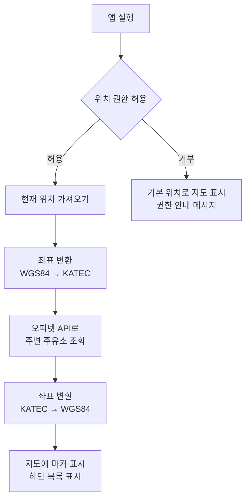

# FindCheapGas

현재 위치를 기준으로 주변의 최저가 주유소를 지도에 보여주는 안드로이드 앱이다.

앱을 실행하면 내 위치를 중심으로 지도가 열리고, 주변 주유소의 기름값이 지도 위에 표시된다.
가장 싼 주유소를 바로 확인할 수 있고, 다른 지역이나 주유소 이름으로 검색하거나 자주 가는 주유소를 즐겨찾기에 저장할 수 있다.

## 목차

1. [주요 기능](#주요-기능)
2. [화면 구성](#화면-구성)
3. [동작 방식](#동작-방식)
4. [기술 스택](#기술-스택)
5. [외부 API](#외부-api)
6. [API 호출 제한 대응](#api-호출-제한-대응)
7. [프로젝트 구조](#프로젝트-구조)
8. [실행 방법](#실행-방법)
9. [개발 진행 상황](#개발-진행-상황)
10. [데이터 출처](#데이터-출처)

## 주요 기능

기능을 중요도에 따라 3단계로 나누고 순서대로 개발한다.

### 1단계 - 핵심 기능

| 기능 | 설명 |
|---|---|
| 현재 위치 지도 | 앱 실행 시 위치 권한을 요청하고, 현재 위치를 중심으로 지도를 띄운다. 현재 위치는 점으로 표시한다. |
| 주변 주유소 표시 | 주변 주유소를 가격과 함께 마커로 표시한다. 가장 싼 주유소는 다른 색으로 표시한다. |
| 유종 선택 | 휘발유, 경유, 고급휘발유, LPG 중에서 선택한다. |
| 반경 선택 | 1km, 3km, 5km 중에서 선택한다. |
| 정렬 | 목록을 가격순 또는 거리순으로 정렬한다. |
| 상세 정보 | 주유소를 누르면 주소, 전화번호, 유종별 가격, 부가시설(셀프, 세차장, 편의점 등)을 보여준다. |

### 2단계 - 주요 기능

| 기능 | 설명 |
|---|---|
| 장소 검색 | 장소(예: 강남역, 해운대구)를 검색하면 지도를 해당 위치로 옮기고 주변 주유소를 보여준다. |
| 주유소 이름 검색 | 주유소 이름으로 검색한다. |
| 즐겨찾기 | 자주 가는 주유소를 저장하고 따로 모아서 본다. |
| 길찾기 | 카카오맵 또는 티맵으로 길안내를 시작한다. |
| 이 지역에서 다시 검색 | 지도를 옮긴 뒤 버튼을 누르면 지도 중심을 기준으로 다시 검색한다. |

### 3단계 - 추가 기능

| 기능 | 설명 |
|---|---|
| 브랜드 필터 | SK에너지, GS칼텍스, 현대오일뱅크, S-OIL, 알뜰주유소 등 원하는 브랜드만 표시한다. |
| 평균가 비교 | 전국 평균가, 지역 평균가와 비교해서 얼마나 싼지 보여준다. |
| 즐겨찾기 가격 변동 | 즐겨찾기한 주유소의 가격이 이전보다 올랐는지 내렸는지 표시한다. |
| 최근 검색어 | 최근에 검색한 장소를 저장한다. |
| 다크 모드 | 어두운 테마를 지원한다. |
| API 사용량 표시 | 오늘 API 호출 횟수를 설정 화면에 표시한다. |

## 화면 구성

```
로딩 화면 - 위치 권한 요청
   │
   ▼
메인 화면 (하단 탭 3개)
 ├─ 지도 탭 (첫 화면)
 │    - 상단: 검색창, 필터(유종, 반경, 브랜드)
 │    - 중앙: 지도 (현재 위치, 주유소 가격 마커)
 │    - 하단: 주유소 목록 (가격순 / 거리순)
 │
 ├─ 즐겨찾기 탭
 │    - 저장한 주유소의 현재 가격과 가격 변동
 │
 └─ 설정 탭
      - 기본 유종, 기본 반경, 선호 브랜드, 다크 모드, 오늘 API 사용량

주유소 상세 화면 (마커나 목록 항목을 누르면 열림)
 - 이름, 브랜드, 주소, 전화번호
 - 유종별 가격, 평균가 대비 차이
 - 셀프 여부, 세차장, 편의점, 경정비 여부
 - 즐겨찾기 / 전화 / 길찾기 버튼
```

화면 캡처는 개발을 진행하면서 추가한다.

## 동작 방식

앱을 실행했을 때 주유소가 지도에 표시되기까지의 흐름은 다음과 같다.



### 좌표 변환

휴대폰 GPS와 카카오맵은 위도·경도(WGS84) 좌표를 사용하고, 오피넷 API는 KATEC 좌표를 사용한다.
따라서 오피넷에 요청할 때는 현재 위치를 KATEC으로 변환하고, 응답으로 받은 주유소 위치는 다시 WGS84로 변환해서 지도에 표시한다.

## 기술 스택

| 구분 | 기술 | 용도 |
|---|---|---|
| 언어 | Java | |
| UI | XML 레이아웃, Fragment, BottomNavigationView | 화면, 하단 탭 |
| 지도 | 카카오맵 Android SDK v2 | 지도, 마커, 현재 위치 표시 |
| 위치 | Google Play Services Location | 현재 위치 조회 |
| 네트워크 | Retrofit2, Gson | API 요청, JSON 파싱 |
| 좌표 변환 | Proj4J | WGS84 ↔ KATEC 변환 |
| 로컬 DB | Room | 즐겨찾기, 최근 검색어, 응답 캐시 |
| 설정 저장 | SharedPreferences | 기본 유종, 반경, API 호출 횟수 |
| 아키텍처 | MVVM (ViewModel, LiveData, Repository) | UI와 데이터 처리 분리 |

## 외부 API

모두 무료로 사용할 수 있다. 키 발급 방법은 [실행 방법](#실행-방법)에 정리했다.

### 오피넷 유가정보 API (한국석유공사)

| API | 용도 |
|---|---|
| 반경 내 주유소 | 현재 위치 주변 주유소와 가격 조회 (최대 반경 5km) |
| 주유소 상세정보 | 주소, 전화번호, 유종별 가격, 부가시설 조회 |
| 상호로 주유소 검색 | 주유소 이름 검색 |
| 전국 / 시도별 평균가격 | 평균가 비교 |

유종 코드는 휘발유 `B027`, 경유 `D047`, 고급휘발유 `B034`, LPG `K015`이다.

### 카카오맵 Android SDK

지도 표시, 마커 표시, 현재 위치 표시에 사용한다.

### 카카오 로컬 API

키워드로 장소를 검색하거나 주소를 좌표로 변환할 때 사용한다.

## API 호출 제한 대응

오피넷 무료 API는 하루 호출 횟수가 300회로 제한되어 있다.
실제로 앱을 사용할 때는 한 번에 5~10회 정도라 문제가 없지만, 개발 중에 앱을 반복해서 실행하면 금방 한도에 도달한다.
그래서 아래 방식을 적용한다.

| 방식 | 내용 |
|---|---|
| 가짜 데이터 모드 | 실제 API 응답을 JSON 파일로 저장해 두고, 개발 중에는 이 파일을 읽는다. `local.properties`의 `USE_MOCK_DATA` 값으로 전환한다. |
| 응답 캐싱 | 같은 위치와 유종으로 조회한 결과는 일정 시간(10~30분) 동안 저장해 두고 재사용한다. 유가는 하루에 몇 번만 바뀌기 때문에 이 정도면 충분하다. |
| 수동 재검색 | 지도를 움직일 때마다 자동으로 조회하지 않고, "이 지역에서 다시 검색" 버튼을 눌렀을 때만 조회한다. |
| 상세 조회 최소화 | 주변 검색 결과에 이름, 가격, 거리, 좌표가 포함되어 있으므로 상세 정보는 주유소를 눌렀을 때만 조회한다. |
| 즐겨찾기 갱신 제한 | 앱을 열 때마다 갱신하지 않고, 당겨서 새로고침하거나 일정 시간이 지났을 때만 가격을 다시 가져온다. |
| 호출 횟수 기록 | 실제 API를 호출할 때마다 오늘 호출 횟수를 기록하고 설정 화면에 표시한다. |

## 프로젝트 구조

개발을 진행하면서 실제 구조에 맞게 수정한다.

```
app/src/main/java/com/example/findcheapgas/
├── ui/                 화면 (Activity, Fragment)
│   ├── map/            지도 탭
│   ├── favorite/       즐겨찾기 탭
│   ├── settings/       설정 탭
│   └── detail/         주유소 상세 화면
├── viewmodel/          화면 데이터 관리
├── data/
│   ├── remote/         오피넷, 카카오 API 통신 (Retrofit)
│   ├── local/          Room DB (즐겨찾기, 검색어, 캐시)
│   ├── mock/           개발용 가짜 데이터
│   └── repository/     데이터 출처 결정 (API / 캐시 / 가짜 데이터)
├── model/              데이터 클래스 (주유소, 가격 등)
└── util/               좌표 변환, 거리 계산 등
```

## 실행 방법

### 1. 개발 환경

- Android Studio
- Java 8
- minSdk 24 (Android 7.0), targetSdk 34
- 안드로이드 실제 기기 (지도와 GPS는 에뮬레이터에서 제대로 동작하지 않을 수 있다)

### 2. API 키 발급

- **오피넷**: [오피넷](https://www.opinet.co.kr)에서 유가정보 API 무료 이용을 신청한다.
- **카카오**: [카카오 디벨로퍼스](https://developers.kakao.com)에서 앱을 추가하고 네이티브 앱 키(지도용)와 REST API 키(검색용)를 확인한다. Android 플랫폼에 패키지명 `com.example.findcheapgas`와 키 해시를 등록하고, 카카오맵 사용 설정을 켠다.
  - 키 해시를 등록하지 않으면 지도가 표시되지 않는다. 앱을 실행하면 Logcat에 키 해시가 출력된다.

### 3. API 키 입력

프로젝트 최상위 폴더의 `local.properties`에 발급받은 키를 추가한다.

```properties
OPINET_API_KEY=오피넷_API_키
KAKAO_NATIVE_APP_KEY=카카오_네이티브_앱_키
KAKAO_REST_API_KEY=카카오_REST_API_키
# true면 가짜 데이터 사용, false면 실제 API 사용
USE_MOCK_DATA=true
```

`local.properties`는 GitHub에 올라가지 않는다. API 키는 코드에 직접 작성하지 않는다.

### 4. 빌드 및 실행

Android Studio에서 프로젝트를 열고 Gradle Sync를 한 뒤, 연결한 휴대폰을 선택해서 실행한다. 처음 실행할 때 위치 권한을 허용한다.

## 개발 진행 상황

- [x] 프로젝트 생성 및 저장소 설정
- [ ] 1단계 - API 키 설정, 가짜 데이터 모드
- [ ] 1단계 - 위치 권한 요청, 현재 위치 지도 표시
- [ ] 1단계 - 주변 주유소 조회, 지도 마커 및 목록 표시
- [ ] 1단계 - 유종, 반경, 정렬 선택
- [ ] 1단계 - 주유소 상세 화면
- [ ] 2단계 - 장소 검색, 주유소 이름 검색
- [ ] 2단계 - 즐겨찾기
- [ ] 2단계 - 길찾기 연동, 이 지역에서 다시 검색
- [ ] 3단계 - 브랜드 필터, 평균가 비교
- [ ] 3단계 - 즐겨찾기 가격 변동, 최근 검색어
- [ ] 3단계 - 다크 모드, API 사용량 표시
- [ ] 예외 처리, UI 정리, 실제 기기 테스트

## 데이터 출처

- 유가 정보: [오피넷 (한국석유공사)](https://www.opinet.co.kr)
- 지도, 장소 검색: [카카오 디벨로퍼스](https://developers.kakao.com)

앱에 표시되는 가격은 오피넷에서 제공하는 정보이므로 실제 주유소 가격과 다를 수 있다.
