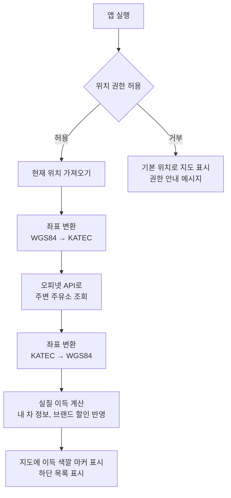

# FindCheapGas

내 차 연비와 할인 카드를 반영해서, 다녀오는 비용까지 계산한 **실제로 가장 이득인 주유소**를 찾아주는 안드로이드 앱입니다.

표시 가격이 가장 싼 주유소가 항상 이득인 것은 아닙니다. 멀리 있는 주유소는 다녀오는 데 기름을 더 쓰고, 카드나 멤버십 할인을 받으면 표시 가격이 더 비싼 주유소가 실제로는 더 쌀 수 있습니다.
이 앱은 주변 주유소 가격에 내 차 정보와 할인 정보를 더해서 "여기서 넣으면 얼마 이득인지"를 계산하고, 지도와 목록에 그 결과를 보여줍니다.

## 목차

1. [오피넷과 다른 점](#오피넷과-다른-점)
2. [실질 이득 계산 방식](#실질-이득-계산-방식)
3. [주요 기능](#주요-기능)
4. [화면 구성](#화면-구성)
5. [동작 방식](#동작-방식)
6. [기술 스택](#기술-스택)
7. [외부 API](#외부-api)
8. [API 호출 제한 대응](#api-호출-제한-대응)
9. [프로젝트 구조](#프로젝트-구조)
10. [실행 방법](#실행-방법)
11. [개발 진행 상황](#개발-진행-상황)
12. [데이터 출처](#데이터-출처)

## 오피넷과 다른 점

유가 정보는 오피넷(한국석유공사)에서 가져오지만, 오피넷 앱이 하지 않는 계산을 합니다.

| | 오피넷 | FindCheapGas |
|---|---|---|
| 답하는 질문 | 어디가 표시 가격이 가장 싼가 | 나는 어디서 넣는 게 가장 이득인가 |
| 순위 기준 | 리터당 표시 가격 | 할인 반영 가격과 다녀오는 비용을 합친 총비용 |
| 내 정보 반영 | 없음 | 내 차 연비, 평소 주유량, 브랜드별 할인, 선호 브랜드 |
| 결과 표시 | 1,640원 | 1,640원 · 1,518원 이득 |
| 지도 마커 색 | 가격 기준 | 실질 이득 기준 (이득 / 비슷 / 손해) |
| 비교 위치 | 현재 위치 | 현재 위치, 집, 회사를 한 화면에서 비교 |
| 확인 방법 | 앱 실행 | 앱 실행, 홈 화면 위젯 |

## 실질 이득 계산 방식

가장 가까운 주유소를 기준으로 삼고, 각 주유소에서 넣었을 때 총비용이 기준보다 얼마나 적은지 계산합니다.

```
내 가격     = 표시 가격 − 내 브랜드 할인 (리터당)
이동 거리   = 직선거리 × 1.3 × 2   (도로 거리 추정, 왕복)
이동 비용   = 이동 거리 ÷ 연비 × 내 가격
총비용      = 내 가격 × 주유량 + 이동 비용
실질 이득   = 기준 주유소 총비용 − 이 주유소 총비용
```

예시 (연비 12km/L, 주유량 40L, 할인 없음)

| | 가장 가까운 주유소 | 3km 떨어진 주유소 |
|---|---|---|
| 표시 가격 | 1,700원 (0.5km) | 1,640원 (3km) |
| 기름값 | 68,000원 | 65,600원 |
| 이동 비용 | 약 184원 | 약 1,066원 |
| 총비용 | 68,184원 | 66,666원 |
| 실질 이득 | 기준 | **1,518원 이득** |

- **왕복으로 계산하는 이유**: 주유하러 주유소에 들렀다가 원래 있던 곳이나 가던 길로 돌아오는 경우를 기준으로 합니다. 앱은 사용자의 목적지를 모르기 때문에, 주유를 위해 추가로 움직이는 거리를 왕복으로 봅니다.
- **1.3을 곱하는 이유**: 실제 도로는 직선이 아니라 돌아가기 때문에 도로 거리는 직선거리보다 깁니다. 도심에서는 보통 직선거리의 1.2~1.4배 정도이므로 중간값인 1.3을 씁니다. 주유소마다 길찾기 API를 부르면 호출이 너무 많아져서 이 방식으로 추정하고, 화면에는 추정치임을 표시합니다.
- 내 차 정보를 입력하지 않으면 기본값(연비 12km/L, 주유량 40L)으로 계산합니다.

## 주요 기능

기능을 4단계로 나누고 순서대로 개발합니다. 앱의 차별점인 실질 이득 계산은 2단계에 두어 먼저 완성합니다.

### 1단계 - 기본 기능

| 기능 | 설명 |
|---|---|
| 현재 위치 지도 | 앱을 실행하면 위치 권한을 요청하고, 현재 위치를 중심으로 지도를 띄웁니다. 현재 위치는 점으로 표시합니다. |
| 주변 주유소 표시 | 주변 주유소를 가격과 함께 마커로 표시하고, 아래 목록에 보여줍니다. |
| 유종 선택 | 휘발유, 경유, 고급휘발유, LPG 중에서 선택합니다. |
| 반경 선택 | 1km, 3km, 5km 중에서 선택합니다. |
| 정렬 | 목록을 가격순 또는 거리순으로 정렬합니다. |
| 상세 정보 | 주유소를 누르면 주소, 전화번호, 유종별 가격, 부가시설(셀프, 세차장, 편의점 등)을 보여줍니다. |

### 2단계 - 차별화 기능

| 기능 | 설명 |
|---|---|
| 내 차 정보 | 처음 실행할 때 연비와 평소 주유량을 입력받습니다. 건너뛸 수 있고, 설정에서 바꿀 수 있습니다. |
| 실질 이득 계산 | 할인과 이동 비용을 반영해서 주유소마다 실질 이득을 계산합니다. 목록에 "OO원 이득"을 표시하고, 기본 정렬을 실질 이득순으로 합니다. |
| 이득 색깔 마커 | 마커 색을 실질 이득 기준으로 칠합니다. 1,000원 이상 이득은 초록, 1,000원 이내 차이는 노랑, 1,000원 이상 손해는 빨강입니다. |
| 내 브랜드 설정 | 브랜드마다 리터당 할인, 선호, 숨기기를 정합니다. 할인은 계산에 반영하고, 선호 브랜드는 이득이 비슷할 때 위로 올리며, 숨긴 브랜드는 표시하지 않습니다. |
| 브랜드 빠른 필터 | 지도 위 필터에서 원하는 브랜드만 보거나, 할인 브랜드만 / 선호 브랜드만 볼 수 있습니다. |

### 3단계 - 주요 기능

| 기능 | 설명 |
|---|---|
| 장소 검색 | 장소(예: 강남역, 해운대구)를 검색하면 지도를 해당 위치로 옮기고 주변 주유소를 보여줍니다. |
| 주유소 이름 검색 | 주유소 이름으로 검색합니다. |
| 즐겨찾기 | 자주 가는 주유소를 저장하고 따로 모아서 봅니다. |
| 길찾기 | 버튼을 누르면 카카오맵 또는 티맵 앱을 열고 해당 주유소를 목적지로 자동 입력합니다. 실제 길안내는 각 앱이 담당합니다. 앱이 설치되어 있지 않으면 플레이스토어 설치 페이지로 이동합니다. |
| 이 지역에서 다시 검색 | 지도를 옮긴 뒤 버튼을 누르면 지도 중심을 기준으로 다시 검색합니다. |

### 4단계 - 추가 기능

| 기능 | 설명 |
|---|---|
| 집·회사 기준 비교 | 집과 회사 위치를 저장해 두고, 지금 위치 / 집 근처 / 회사 근처 중 어디서 넣는 게 가장 이득인지 한 화면에서 비교합니다. |
| 홈 화면 위젯 | 앱을 열지 않아도 홈 화면에서 이득 1위 주유소와 가격, 이득 금액을 보여줍니다. 집이나 회사 위치 기준으로 보여주므로 백그라운드 위치 권한이 필요 없습니다. |
| 7일 가격 추이 | 최근 7일 전국 평균가를 그래프로 보여줍니다. 가격을 예측하지 않고 추이만 보여줍니다. |
| 평균가 비교 | 전국 평균가, 지역 평균가와 비교해서 얼마나 싼지 보여줍니다. |
| 다크 모드 | 어두운 테마를 지원합니다. |
| API 사용량 표시 | 오늘 API 호출 횟수를 설정 화면에 표시합니다. |

### 여유가 있으면 추가할 기능

| 기능 | 설명 |
|---|---|
| 가는 길에 들르기 | 목적지를 입력하면 경로 근처 주유소 중 돌아가는 거리가 적고 이득이 큰 곳을 추천합니다. |
| 목표가 알림 | 즐겨찾기 주유소가 정한 가격 아래로 내려가면 알림을 보냅니다. |

## 화면 구성

```
로딩 화면 - 위치 권한 요청
   │
   ▼
처음 실행 시 - 내 차 정보 입력 (연비, 평소 주유량, 건너뛰기 가능)
   │
   ▼
메인 화면 (하단 탭 3개)
 ├─ 지도 탭 (첫 화면)
 │    - 상단: 검색창, 필터(유종, 반경, 브랜드)
 │    - 중앙: 지도 (현재 위치, 실질 이득 색깔 가격 마커)
 │    - 하단: 주유소 목록 (실질 이득순 / 가격순 / 거리순, 가격과 이득 금액)
 │
 ├─ 즐겨찾기 탭
 │    - 집·회사 기준 비교 (지금 위치 / 집 근처 / 회사 근처 이득 1위)
 │    - 저장한 주유소의 현재 가격과 실질 이득
 │
 └─ 설정 탭
      - 내 차 정보 (연비, 평소 주유량)
      - 내 브랜드 (할인, 선호, 숨기기)
      - 집·회사 위치, 기본 유종, 기본 반경, 다크 모드, 오늘 API 사용량

주유소 상세 화면 (마커나 목록 항목을 누르면 열림)
 - 이름, 브랜드, 주소, 전화번호
 - 유종별 가격, 평균가 대비 차이, 7일 가격 추이
 - 실질 이득 계산 내역 (기름값 차이, 이동 비용)
 - 셀프 여부, 세차장, 편의점, 경정비 여부
 - 즐겨찾기 / 전화 / 길찾기 버튼

홈 화면 위젯
 - 집 또는 회사 근처 이득 1위 주유소, 가격, 이득 금액, 갱신 시각
 - 누르면 앱이 열리고 해당 주유소로 이동
```

화면 캡처는 개발을 진행하면서 추가합니다.

## 동작 방식

앱을 실행했을 때 주유소가 지도에 표시되기까지의 흐름은 다음과 같습니다.



### 좌표 변환

휴대폰 GPS와 카카오맵은 위도·경도(WGS84) 좌표를 사용하고, 오피넷 API는 KATEC 좌표를 사용합니다.
따라서 오피넷에 요청할 때는 현재 위치를 KATEC으로 변환하고, 응답으로 받은 주유소 위치는 다시 WGS84로 변환해서 지도에 표시합니다.

## 기술 스택

| 구분 | 기술 | 용도 |
|---|---|---|
| 언어 | Java | |
| UI | XML 레이아웃, Fragment, BottomNavigationView | 화면, 하단 탭 |
| 지도 | 카카오맵 Android SDK v2 | 지도, 마커, 현재 위치 표시 |
| 위치 | Google Play Services Location | 현재 위치 조회 |
| 네트워크 | Retrofit2, Gson | API 요청, JSON 파싱 |
| 좌표 변환 | Proj4J | WGS84 ↔ KATEC 변환 |
| 로컬 DB | Room | 즐겨찾기, 집·회사 위치, 응답 캐시 |
| 설정 저장 | SharedPreferences | 내 차 정보, 내 브랜드 설정, 선택한 유종·반경·정렬, API 호출 횟수 |
| 위젯 | AppWidget, WorkManager | 홈 화면 위젯, 주기적 갱신 |
| 아키텍처 | MVVM (ViewModel, LiveData, Repository) | UI와 데이터 처리 분리 |

## 외부 API

모두 무료로 사용할 수 있습니다. 키 발급 방법은 [실행 방법](#실행-방법)에 정리했습니다.

### 오피넷 유가정보 API (한국석유공사)

| API | 용도 |
|---|---|
| 반경 내 주유소 | 현재 위치 주변 주유소와 가격 조회 (최대 반경 5km) |
| 주유소 상세정보 | 주소, 전화번호, 유종별 가격, 부가시설 조회 |
| 상호로 주유소 검색 | 주유소 이름 검색 |
| 전국 / 시도별 평균가격 | 평균가 비교 |
| 최근 7일간 전국 일일 평균가격 | 7일 가격 추이 |

유종 코드는 휘발유 `B027`, 경유 `D047`, 고급휘발유 `B034`, LPG `K015`입니다.

### 카카오맵 Android SDK

지도 표시, 마커 표시, 현재 위치 표시에 사용합니다.

### 카카오 로컬 API

키워드로 장소를 검색하거나 주소를 좌표로 변환할 때 사용합니다. 집·회사 위치 등록에도 사용합니다.

## API 호출 제한 대응

오피넷 무료 API는 하루 호출 횟수가 300회로 제한되어 있습니다.
실제로 앱을 사용할 때는 한 번에 5~10회 정도라 문제가 없지만, 개발 중에 앱을 반복해서 실행하면 금방 한도에 도달합니다.
그래서 아래 방식을 적용합니다.

| 방식 | 내용 |
|---|---|
| 가짜 데이터 모드 | 실제 API 응답과 같은 구조의 JSON 파일을 두고, 개발 중에는 이 파일을 읽습니다. `local.properties`의 `USE_MOCK_DATA` 값으로 전환합니다. |
| 응답 캐싱 | 같은 위치와 유종으로 조회한 결과는 일정 시간(10~30분) 동안 저장해 두고 재사용합니다. 유가는 하루에 몇 번만 바뀌기 때문에 이 정도면 충분합니다. |
| 앱 안에서 다시 계산 | 정렬, 반경, 브랜드 필터, 내 차 정보, 할인 설정을 바꿀 때는 API를 다시 부르지 않고 이미 받은 목록으로 다시 계산합니다. |
| 수동 재검색 | 지도를 움직일 때마다 자동으로 조회하지 않고, "이 지역에서 다시 검색" 버튼을 눌렀을 때만 조회합니다. |
| 상세 조회 최소화 | 주변 검색 결과에 이름, 가격, 거리, 좌표가 포함되어 있으므로 상세 정보는 주유소를 눌렀을 때만 조회합니다. |
| 갱신 주기 제한 | 즐겨찾기와 집·회사 비교는 당겨서 새로고침하거나 일정 시간이 지났을 때만 다시 가져옵니다. 위젯은 3시간마다 갱신하고, 7일 추이는 하루에 한 번만 가져옵니다. |
| 호출 횟수 기록 | 실제 API를 호출할 때마다 오늘 호출 횟수를 기록하고 설정 화면에 표시합니다. |

## 프로젝트 구조

개발을 진행하면서 실제 구조에 맞게 수정합니다.

```
app/src/main/java/com/example/findcheapgas/
├── FindCheapGasApp.java          Application 클래스 (카카오맵 SDK 초기화, 지도 사용 가능 여부, 디버그 키 해시 출력)
├── MainActivity.java             메인 화면 (로딩 화면, 하단 탭 3개 전환)
├── ui/                           화면 (Fragment)
│   ├── map/
│   │   ├── MapFragment.java      지도 탭 (위치 권한 요청, 카카오맵, 내 위치, 주유소 목록 시트)
│   │   ├── StationMarkers.java   지도 위 주유소 가격 마커 (최저가 강조, 선택 표시)
│   │   └── StationAdapter.java   아래 시트의 주유소 목록 (순위, 상호, 브랜드, 가격, 거리)
│   ├── favorite/
│   │   └── FavoriteFragment.java 즐겨찾기 탭 (준비 중)
│   └── settings/
│       └── SettingsFragment.java 설정 탭 (준비 중)
├── viewmodel/
│   └── MapViewModel.java         지도 탭 화면 상태 (현재 좌표, 권한, 주유소 목록, 로딩, 오류, 선택한 주유소)
├── data/
│   ├── remote/                   오피넷 API 통신 (Retrofit)
│   │   ├── OpinetApi.java        반경 내 주유소(aroundAll.do) 요청 정의
│   │   ├── OpinetAroundResponse.java 응답 구조와 해석 (가짜 데이터도 같은 구조)
│   │   ├── OpinetRemoteDataSource.java 실제 API 호출
│   │   └── OpinetException.java  오피넷 오류 응답 (한도 초과, 형식 오류 등)
│   ├── local/                    기기에 저장하는 데이터
│   │   ├── AppDatabase.java      Room DB
│   │   ├── StationCacheEntity.java 주변 주유소 조회 결과 캐시 (20분)
│   │   ├── StationCacheDao.java  캐시 조회, 저장, 오래된 캐시 삭제
│   │   └── ApiCallCounter.java   오늘 오피넷 API 호출 횟수 (SharedPreferences)
│   ├── mock/
│   │   └── MockOpinetDataSource.java 가짜 데이터 읽기 (반경 밖 주유소 제외)
│   └── repository/
│       ├── LocationRepository.java 현재 위치 조회 (현재 위치 → 마지막 위치 → 기본 위치)
│       └── StationRepository.java 주유소 데이터 출처 결정 (캐시 → 가짜 데이터 또는 실제 API)
├── model/
│   ├── UserLocation.java         위치 좌표와 출처
│   ├── LocationPermissionState.java 위치 권한 상태
│   ├── GasStation.java           주유소 (이름, 브랜드, 가격, 거리, KATEC·WGS84 좌표)
│   ├── StationQuery.java         주변 주유소 조회 조건 (위치, 유종, 반경, 정렬)
│   ├── StationError.java         조회 실패 원인 (네트워크, 오피넷)
│   ├── FuelType.java             유종 코드 (휘발유, 경유, 고급휘발유, LPG)
│   ├── SortOrder.java            정렬 기준 (가격순, 거리순)
│   └── Brand.java                브랜드 코드 → 한글 이름
└── util/
    ├── CoordinateConverter.java  WGS84 ↔ KATEC 좌표 변환 (Proj4J)
    ├── FormatUtil.java           가격(1,659원), 거리(1.2km) 표시 형식
    └── KeyHashUtil.java          앱 서명 키 해시 계산 (카카오 디벨로퍼스 등록용)

app/src/main/assets/mock/         가짜 데이터 (강남역 주변, 유종별 around_B027.json 등)
```

아래 패키지는 해당 기능을 만들 때 추가합니다.

```
├── ui/
│   ├── detail/         주유소 상세 화면
│   └── onboarding/     처음 실행 시 내 차 정보 입력
├── widget/             홈 화면 위젯, 주기적 갱신
├── data/
│   └── remote/         카카오 로컬 API 통신
└── util/               실질 이득 계산
```

## 실행 방법

### 1. 개발 환경

- Android Studio
- Java 8
- minSdk 24 (Android 7.0), targetSdk 34
- 안드로이드 실제 기기 (지도와 GPS는 에뮬레이터에서 제대로 동작하지 않을 수 있습니다)

### 2. API 키 발급

- **오피넷**: [오피넷](https://www.opinet.co.kr)에서 유가정보 API 무료 이용을 신청합니다.
- **카카오**: [카카오 디벨로퍼스](https://developers.kakao.com)에서 앱을 추가하고 네이티브 앱 키(지도용)와 REST API 키(검색용)를 확인합니다. Android 플랫폼에 패키지명 `com.example.findcheapgas`와 키 해시를 등록하고, 카카오맵 사용 설정을 켭니다.
  - 키 해시를 등록하지 않으면 지도가 표시되지 않습니다. 앱을 실행하면 Logcat에 키 해시가 출력됩니다.

### 3. API 키 입력

프로젝트 최상위 폴더의 `local.properties`에 발급받은 키를 추가합니다.

```properties
OPINET_API_KEY=오피넷_API_키
KAKAO_NATIVE_APP_KEY=카카오_네이티브_앱_키
KAKAO_REST_API_KEY=카카오_REST_API_키
# true면 가짜 데이터 사용, false면 실제 API 사용
USE_MOCK_DATA=true
```

`local.properties`는 GitHub에 올라가지 않습니다. API 키는 코드에 직접 작성하지 않습니다.

### 4. 빌드 및 실행

Android Studio에서 프로젝트를 열고 Gradle Sync를 한 뒤, 연결한 휴대폰을 선택해서 실행합니다. 처음 실행할 때 위치 권한을 허용합니다.

## 개발 진행 상황

- [x] 프로젝트 생성 및 저장소 설정
- [x] 1단계 - API 키 설정, 기본 라이브러리 구성
- [x] 1단계 - 가짜 데이터 모드, API 응답 캐싱
- [x] 1단계 - 위치 권한 요청, 현재 위치 지도 표시
- [x] 1단계 - 주변 주유소 조회, 지도 마커 및 목록 표시
- [ ] 1단계 - 유종, 반경, 정렬 선택
- [ ] 1단계 - 주유소 상세 화면
- [ ] 2단계 - 내 차 정보 입력 (처음 실행, 설정)
- [ ] 2단계 - 실질 이득 계산, 실질 이득순 정렬, 이득 색깔 마커
- [ ] 2단계 - 내 브랜드 설정 (할인, 선호, 숨기기), 브랜드 빠른 필터
- [ ] 3단계 - 장소 검색, 주유소 이름 검색
- [ ] 3단계 - 즐겨찾기
- [ ] 3단계 - 길찾기 연동, 이 지역에서 다시 검색
- [ ] 4단계 - 집·회사 기준 비교
- [ ] 4단계 - 홈 화면 위젯
- [ ] 4단계 - 7일 가격 추이, 평균가 비교
- [ ] 4단계 - 다크 모드, API 사용량 표시
- [ ] 예외 처리, UI 정리, 실제 기기 테스트

## 데이터 출처

- 유가 정보: [오피넷 (한국석유공사)](https://www.opinet.co.kr)
- 지도, 장소 검색: [카카오 디벨로퍼스](https://developers.kakao.com)

앱에 표시되는 가격은 오피넷에서 제공하는 정보이므로 실제 주유소 가격과 다를 수 있습니다. 실질 이득은 도로 거리를 추정해서 계산한 값이므로 실제와 차이가 있을 수 있습니다.
